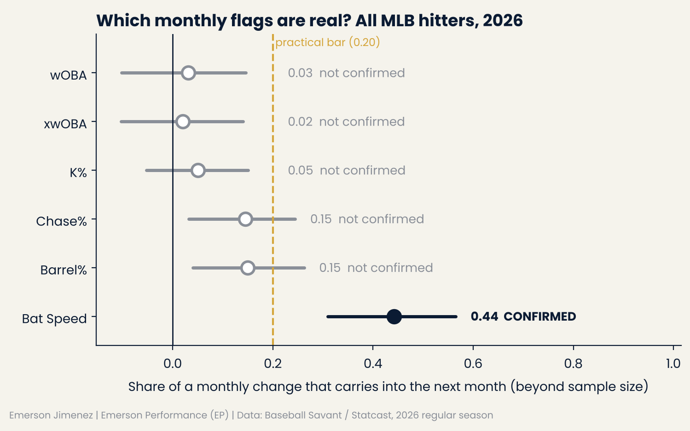
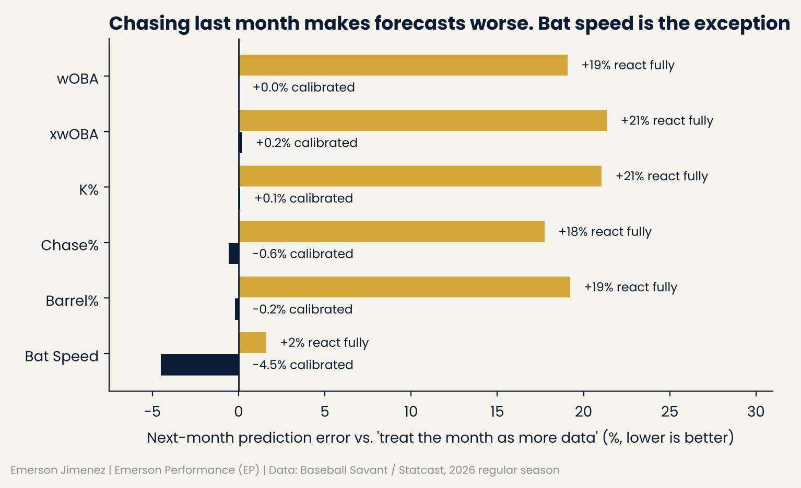
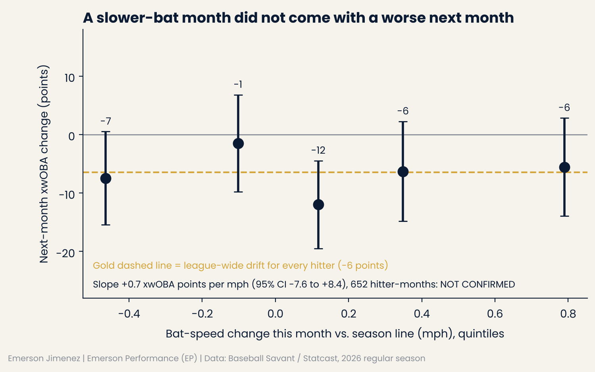

# EP Hitter Monthly Tracker: which monthly flags are real?

**Bat speed is the only monthly change that sticks, but it did not predict next month's production.**

- Across all MLB hitters in 2026, **44%** of a month's bat-speed change (vs. the hitter's season line) showed up again the next month (95% CI 0.31–0.57), beyond what the month's sample size already explains.
- For **wOBA, xwOBA and K%**, a hot or cold month carried over **nothing measurable** (persistence 0.02–0.05, CIs include 0).
- Reacting fully to the last month made next-month forecasts **18–21% worse** for every results and approach metric.
- A slower-bat month did **not** come with a worse next month in xwOBA, Barrel% or exit velocity (xwOBA slope +0.7 points per mph, 95% CI −7.6 to +8.4).
- So a bat-speed flag is a real **physical** signal, not a production forecast.

*Data: Baseball Savant / Statcast, 2026 regular season, all 30 teams (716,792 pitches, 183,849 PA, 662 hitters). Author: Emerson Jimenez, Emerson Performance (EP).*

*English first · [Español abajo](#versión-en-español)*



| Metric | Pairs (hitters) | Persistence | 95% CI | q-value | Label |
|---|---|---|---|---|---|
| wOBA | 652 (242) | 0.03 | −0.10 to 0.15 | 0.74 | NOT CONFIRMED: no evidence it carries over |
| xwOBA | 652 (242) | 0.02 | −0.10 to 0.14 | 0.74 | NOT CONFIRMED: no evidence it carries over |
| K% | 658 (246) | 0.05 | −0.05 to 0.15 | 0.49 | NOT CONFIRMED: no evidence it carries over |
| Chase% | 657 (246) | 0.15 | 0.03 to 0.24 | 0.014 | NOT CONFIRMED: real but small (below the 0.20 bar) |
| Barrel% | 635 (236) | 0.15 | 0.04 to 0.26 | 0.014 | NOT CONFIRMED: real but small (below the 0.20 bar) |
| **Bat Speed** | **658 (246)** | **0.44** | **0.31 to 0.57** | **<0.001** | **CONFIRMED** |

**Decision (front office / hitting staff):**
- A **▼ Bat Speed** month is a real change in the hitter's body or swing: route it to the strength, medical and hitting staff (workload, recovery, health). Do **not** use it to forecast next month's production: in 2026 it added nothing beyond the hitter's own xwOBA.
- A hot or cold **wOBA/xwOBA/K%** month is just more data. The season line already gives it the right weight; don't change a player's role over one month.
- **Chase% and Barrel%** move a little (about 15% carries over). Watch them; don't act on them alone.

---

## The question

Teams look at hitters month by month. The decision is **how much a monthly change should move us**: is it a real change in the player, or noise that will disappear?

## The deliverables

1. **`outputs/MLB_Hitter_Monthly_Tracker_2026.xlsx`**: an Excel tracker for all 30 teams. Pick a team and a hitter (yellow cells).
   - **Player Card**: 21 metrics by month + season, with charts.
   - **Team**: team offense by month next to the MLB line.
   - **Trend Grid**: heat maps (hitters × months) for xwOBA, Barrel%, Chase% and Bat Speed.
   - **Monthly Tracker**: every team-hitter-month in MLB with flags (▲/▼ Bat Speed, Contact, Chase).
   - **Signal Weights**: the league test below, inside the workbook.
   - Every rate is a **live formula** on the Counts tabs (93,916 formulas, 0 errors).
2. **A league-wide test** of which monthly flags carry into the next month, and whether a bat-speed change comes with next month's production (this README).

## Method

**Baseline (key design choice).** For month *t* (May–Aug), the baseline is the hitter's season-to-date line **through** month *t*, with counts pooled, so month *t* is weighted by its own sample size.
- `change = month t − baseline`, `next change = month t+1 − baseline`.
- **Persistence** = slope of next change on change (with an intercept for league-wide seasonal drift).
- 0 = the month is just more data. 1 = the whole change is real and stays.

**Why not compare the month with the prior months only?** Because the noise in that prior baseline sits on both sides of the regression and creates **fake persistence**. On a synthetic league where no hitter ever changes, that naive design gives persistence 0.37 and would be labeled CONFIRMED. The pooled baseline gives 0.02 (CI includes 0). Both results are in `tests/test_synthetic.py`.

**Forecast test (leave-one-player-out, MAE on month t+1):**
- **A: no extra reaction.** Baseline + drift.
- **B: full reaction.** Month *t* repeats.
- **C: calibrated.** Baseline + drift + persistence × change.

**Statistics:**
- Player-clustered bootstrap (2,000 reps) for all CIs.
- Benjamini-Hochberg across the 6 metrics.
- Paired Cohen's d on absolute errors.

**Rules set before the real run:**
- Persistence **CONFIRMED** = q < 0.05 **and** persistence ≥ 0.20.
- C beats A = 95% CI of the MAE gain above 0 **and** gain ≥ 2%.

**Samples:**
- 60+ PA in both months and 80+ PA before month *t*.
- Minimum denominators: 100 out-of-zone pitches (Chase%), 40 batted balls (Barrel%), 40 competitive swings (Bat Speed).

**Absences filtered from the start.** Every hitter-month touched by a 14+ day gap between games (IL, demotion) or by a season that ended 14+ days early is excluded (1,409 hitter-months flagged, most of them part-time players who would not qualify anyway). `data/injury_exclusions.csv` is available for manual exclusions with a public source. **Sensitivity:** without the absence filter the result is the same (bat speed 0.43, CI 0.31–0.55; all others not confirmed). See `results/sensitivity_no_absence_filter.csv`.

## Results in detail



| Metric | MAE no extra reaction | MAE calibrated | MAE full reaction | Calibrated vs none |
|---|---|---|---|---|
| wOBA | .0514 | .0514 | .0612 | NOT CONFIRMED |
| xwOBA | .0379 | .0380 | .0460 | NOT CONFIRMED |
| K% | .0409 | .0409 | .0495 | NOT CONFIRMED |
| Chase% | .0357 | .0355 | .0421 | NOT CONFIRMED |
| Barrel% | .0307 | .0306 | .0366 | NOT CONFIRMED |
| **Bat Speed (mph)** | **0.533** | **0.508** | 0.541 | **CONFIRMED (−4.5%, CI of gain 0.009–0.040 mph)** |

- **CONFIRMED:** Bat speed persistence 0.44 and the calibrated bat-speed forecast beats "no extra reaction" by 4.5%. The effect is small per pair (paired d = 0.13), but it is consistent.
- **CONFIRMED:** Repeating last month (full reaction) made the forecast worse for wOBA, xwOBA, K%, Chase% and Barrel% (+18% to +21% error, all CIs above 0).
- **NOT CONFIRMED:** Monthly results (wOBA, xwOBA) and K% carried over. Their persistence CIs include 0. **This null result is the practical finding: don't overreact to a hot or cold month.**
- **INTERPRETATION:** Bat speed is a physical output: it depends on fatigue, strength, health and swing intent. When it changes, the cause usually stays for weeks. Results and plate-discipline rates are driven more by opponents, luck and sample size.
- **How to read a flag:** expected next-month change ≈ persistence × this month's change. A hitter 1.0 mph below his season bat speed → expect about 0.4 mph below next month.

## Does a bat-speed change come with next month's production?

**Question.** When a hitter's bat speed drops this month, does his production drop next month, beyond what this month's xwOBA already shows?

**Model.** `next-month change = a + b × bat-speed change + c × this month's change`, on the same pairs, baseline and filters as above.

**Rules set before the real run:**
- Outcomes: xwOBA (primary), Barrel% and Avg EV (secondary), Benjamini-Hochberg across the 3.
- CONFIRMED = q < 0.05 **and** b at or above a practical bar in the expected direction: .010 xwOBA, 0.5 Barrel% points or 0.5 mph EV per 1 mph of bat speed.
- Known-answer synthetic tests (real link, no link, reversed link) in `tests/test_batspeed_link.py` passed before the real data was used.



| Outcome | Pairs (hitters) | b per 1 mph of bat speed | 95% CI | q-value | Label |
|---|---|---|---|---|---|
| xwOBA | 652 (242) | +.0007 | −.0076 to +.0084 | 0.89 | NOT CONFIRMED |
| Barrel% | 635 (236) | +0.05 pts | −0.71 to +0.79 pts | 0.89 | NOT CONFIRMED |
| Avg EV | 635 (236) | +0.13 mph | −0.28 to +0.55 mph | 0.89 | NOT CONFIRMED |

- **NOT CONFIRMED:** a slower-bat month did not come with a worse next month. Adding bat speed did not improve the next-month xwOBA forecast (−0.4%).
- The CI rules out a link of .010 xwOBA or more per mph at the monthly level. If a link exists, it is smaller than that or works on a longer time scale.
- **Descriptive only (not pre-registered as a test, n = 12):** the few hitter-months 0.75+ mph below their season line averaged 1.4 mph lower EV the next month (CI −2.8 to −0.2). Too few cases to act on; worth re-testing with 2024–2025 data.
- **INTERPRETATION:** a bat-speed drop is best read as a physical and health signal for the strength, medical and hitting staff, not as an early warning of a production slump.

## Limitations

- **One season (2026).** Persistence should be re-tested on other years before it is used as a fixed weight.
- **Monthly windows are coarse.** A change in the middle of a month is split between two months.
- **Competitive-swing cutoff.** It uses each hitter's full-season swings (as on Savant), so the monthly bat speed uses a season-level threshold.
- **Bat-tracking calibration by park** can add noise; a trade changes a hitter's home park for good.
- **Not causal.** A change in bat speed *came with* a lasting change; this design does not show why.

## Reproduce

```bash
pip install -r requirements.txt
python run_all.py   # download -> counts -> synthetic tests -> league test -> bat-speed link -> validation -> charts -> Excel
```

| Step | File |
|---|---|
| Download (regular season, needed columns only; raw CSVs are not committed) | `src/pull_data.py` |
| Hitter-month counts, absence flags | `src/counts.py`, `src/build_counts.py` |
| Known-answer tests (null, real change, reversal, naive-baseline warning) | `tests/test_synthetic.py` |
| League test | `src/persistence_test.py` → `results/` |
| Bat speed → next-month production (+ known-answer tests) | `src/batspeed_to_results.py`, `tests/test_batspeed_link.py` |
| Validation against Savant leaderboards | `src/validate.py` → `results/validation_vs_savant.json` |
| Charts (EP style, direct labels) | `src/make_charts.py`, `src/ep_chart_style.py` |
| Excel tracker | `src/build_tracker.py` → `outputs/` |

**Validation against Baseball Savant leaderboards:**
- Expected-stats leaderboard (662 hitters): PA match 100%, wOBA median difference .001, xwOBA median difference .0003.
- Bat-tracking leaderboard (519 hitters): average bat speed median difference 0.05 mph.

## Correction log

- **Before release:** the first design measured the month against the prior months only. Synthetic tests showed it creates fake persistence (0.37 in a league with no real changes). The pooled baseline replaced it before any real-data result was published. The warning test stays in `tests/` so the error cannot come back.
- **Before release:** a draft said a bat-speed drop "shows up before results". That claim had not been tested. It was then tested (`src/batspeed_to_results.py`), was not supported, and was removed.

---

# Versión en español

**La velocidad de bate es el único cambio mensual que se mantiene, pero no predijo la producción del mes siguiente.**

- En todos los bateadores de MLB en 2026, el **44%** del cambio de bat speed de un mes (frente a la línea de la temporada) apareció otra vez al mes siguiente (IC 95% 0.31–0.57), más allá de lo que explica el tamaño de muestra del mes.
- En **wOBA, xwOBA y K%**, un mes caliente o frío **no dejó nada medible** (persistencia 0.02–0.05, los IC incluyen 0).
- Reaccionar por completo al último mes empeoró el pronóstico del mes siguiente **entre 18% y 21%**.
- Un mes con el bate más lento **no** vino con un peor mes siguiente en xwOBA, Barrel% ni velocidad de salida (pendiente de xwOBA +0.7 puntos por mph, IC 95% −7.6 a +8.4).
- Una alerta de bat speed es una señal **física** real, no un pronóstico de producción.

*Datos: Baseball Savant / Statcast, temporada regular 2026, los 30 equipos (716,792 lanzamientos, 183,849 PA, 662 bateadores). Autor: Emerson Jimenez, Emerson Performance (EP).*

**Decisión (front office / cuerpo técnico de bateo):**
- Un mes con **▼ Bat Speed** es un cambio real en el cuerpo o el swing del bateador: llevarlo al cuerpo de fuerza, médico y de bateo (carga, recuperación, salud). **No** usarlo para pronosticar la producción del mes siguiente: en 2026 no añadió nada más allá del propio xwOBA del bateador.
- Un mes caliente o frío en **wOBA/xwOBA/K%** es solo más datos. La línea de la temporada ya le da el peso correcto; no cambiar el rol de un jugador por un mes.
- **Chase% y Barrel%** se mueven un poco (se mantiene alrededor del 15%). Vigilarlos, pero no actuar solo por ellos.

## La pregunta

Los equipos ven a los bateadores mes a mes. La decisión es **cuánto debe movernos un cambio mensual**: ¿es un cambio real del jugador o ruido que va a desaparecer?

## Los entregables

1. **`outputs/MLB_Hitter_Monthly_Tracker_2026.xlsx`**: Excel para los 30 equipos. Se elige un equipo y un bateador (celdas amarillas).
   - **Player Card**: 21 métricas por mes y temporada, con gráficas.
   - **Team**: ofensiva del equipo por mes junto a la línea de MLB.
   - **Trend Grid**: mapas de calor (bateadores × meses) de xwOBA, Barrel%, Chase% y Bat Speed.
   - **Monthly Tracker**: todos los meses de cada bateador de MLB, con alertas (▲/▼ Bat Speed, Contact, Chase).
   - **Signal Weights**: la prueba de liga dentro del Excel.
   - Todas las tasas son **fórmulas vivas** sobre las pestañas Counts (93,916 fórmulas, 0 errores).
2. **Una prueba de toda la liga** sobre qué alertas mensuales se mantienen al mes siguiente y si un cambio de bat speed viene con la producción del mes siguiente.

## Método

**Línea base (decisión clave).** Para el mes *t* (mayo–agosto), la línea base es la temporada del bateador hasta el mes *t* **inclusive**, sumando los conteos, así el mes *t* pesa según su propia muestra.
- **Persistencia** = pendiente del cambio del mes siguiente sobre el cambio del mes *t*.
- 0 = el mes es solo más datos. 1 = todo el cambio es real y se queda.

**¿Por qué no comparar el mes solo con los meses anteriores?** Porque el ruido de esa base aparece en los dos lados y crea **persistencia falsa**. En una liga sintética donde ningún bateador cambia, ese diseño ingenuo da 0.37 y saldría CONFIRMED. La base acumulada da 0.02 (el IC incluye 0). Las dos pruebas están en `tests/test_synthetic.py`.

**Prueba de pronóstico (dejando fuera a un jugador a la vez, MAE del mes t+1):**
- **A: sin reacción extra.**
- **B: reacción completa.** El mes *t* se repite.
- **C: calibrado.** Base + persistencia × cambio.

**Estadística:**
- Bootstrap por jugador (2,000 repeticiones) para los IC.
- Benjamini-Hochberg en las 6 métricas.
- d de Cohen pareada.

**Reglas fijadas antes de correr los datos reales:**
- **CONFIRMED** = q < 0.05 **y** persistencia ≥ 0.20.
- C le gana a A = IC del ahorro de error sobre 0 **y** ahorro ≥ 2%.

**Ausencias filtradas desde el inicio.** Se excluye todo mes tocado por un hueco de 14+ días sin jugar (lista de lesionados, bajada a ligas menores) o por una temporada que terminó 14+ días antes. **Sensibilidad:** sin ese filtro el resultado es el mismo (bat speed 0.43; las demás, no confirmadas).

## Resultados

- **CONFIRMED:** persistencia de bat speed 0.44; el pronóstico calibrado de bat speed reduce el error 4.5%. El efecto por pareja es pequeño (d = 0.13), pero consistente.
- **CONFIRMED:** repetir el último mes empeoró el pronóstico de wOBA, xwOBA, K%, Chase% y Barrel% (+18% a +21% de error).
- **NOT CONFIRMED:** que wOBA, xwOBA o K% se mantengan. **Este resultado nulo es la conclusión práctica: no sobrerreaccionar a un mes caliente o frío.**
- **INTERPRETATION:** el bat speed es una salida física: depende de la fatiga, la fuerza, la salud y la intención del swing. Cuando cambia, la causa suele quedarse semanas. Los resultados y la disciplina dependen más del rival, la suerte y la muestra.
- **Cómo leer una alerta:** cambio esperado el mes siguiente ≈ persistencia × cambio de este mes. Un bateador 1.0 mph por debajo de su temporada → esperar unas 0.4 mph por debajo el mes siguiente.

**¿Un cambio de bat speed viene con la producción del mes siguiente?**
- **Pregunta:** cuando el bat speed baja este mes, ¿baja la producción el mes siguiente, más allá de lo que ya muestra el xwOBA de este mes?
- **Reglas fijadas antes:** xwOBA (principal), Barrel% y EV (secundarios), Benjamini-Hochberg; CONFIRMED = q < 0.05 y al menos .010 de xwOBA (0.5 puntos de Barrel%, 0.5 mph de EV) por cada mph. Las pruebas sintéticas (con relación, sin relación, relación al revés) pasaron antes de usar los datos reales.
- **NOT CONFIRMED** en los tres: xwOBA +.0007 por mph (IC −.0076 a +.0084), Barrel% +0.05 puntos (IC −0.71 a +0.79), EV +0.13 mph (IC −0.28 a +0.55). El IC descarta una relación de .010 de xwOBA o más por mph a nivel mensual.
- **Solo descriptivo (n = 12):** los pocos meses con 0.75+ mph por debajo de su temporada tuvieron 1.4 mph menos de EV el mes siguiente (IC −2.8 a −0.2). Muy pocos casos para actuar; hay que repetirlo con 2024–2025.
- **INTERPRETATION:** una caída de bat speed se lee mejor como señal física y de salud para el cuerpo de fuerza, médico y de bateo, no como aviso temprano de una mala racha.

## Limitaciones

- **Una sola temporada.** Hay que repetir la prueba con otros años.
- **Las ventanas mensuales son gruesas.** Un cambio a mitad de mes queda partido entre dos meses.
- **Swing competitivo.** El corte usa toda la temporada de cada bateador (como Savant).
- **Calibración del bat tracking por estadio.** Puede añadir ruido.
- **No es causal.** Un cambio de bat speed *vino con* un cambio duradero; el diseño no muestra por qué.

## Reproducir

```bash
pip install -r requirements.txt
python run_all.py
```

**Validación contra los leaderboards de Savant:**
- Estadísticas esperadas (662 bateadores): PA iguales 100%, wOBA diferencia mediana .001, xwOBA .0003.
- Bat tracking (519 bateadores): bat speed diferencia mediana 0.05 mph.

## Registro de correcciones

- **Antes de publicar:** el primer diseño comparaba el mes solo con los meses anteriores. Las pruebas sintéticas mostraron que crea persistencia falsa (0.37 en una liga sin cambios reales). Se reemplazó por la base acumulada antes de publicar cualquier resultado con datos reales. La prueba de advertencia queda en `tests/`.
- **Antes de publicar:** un borrador decía que una caída de bat speed "aparece antes que los resultados". No estaba probado. Se probó (`src/batspeed_to_results.py`), no se confirmó y se quitó.

---
Emerson Jimenez · Emerson Performance (EP) · [ejimenezperformance.github.io](https://ejimenezperformance.github.io)
Data: Baseball Savant / MLB Advanced Media. Not affiliated with MLB or any club.
